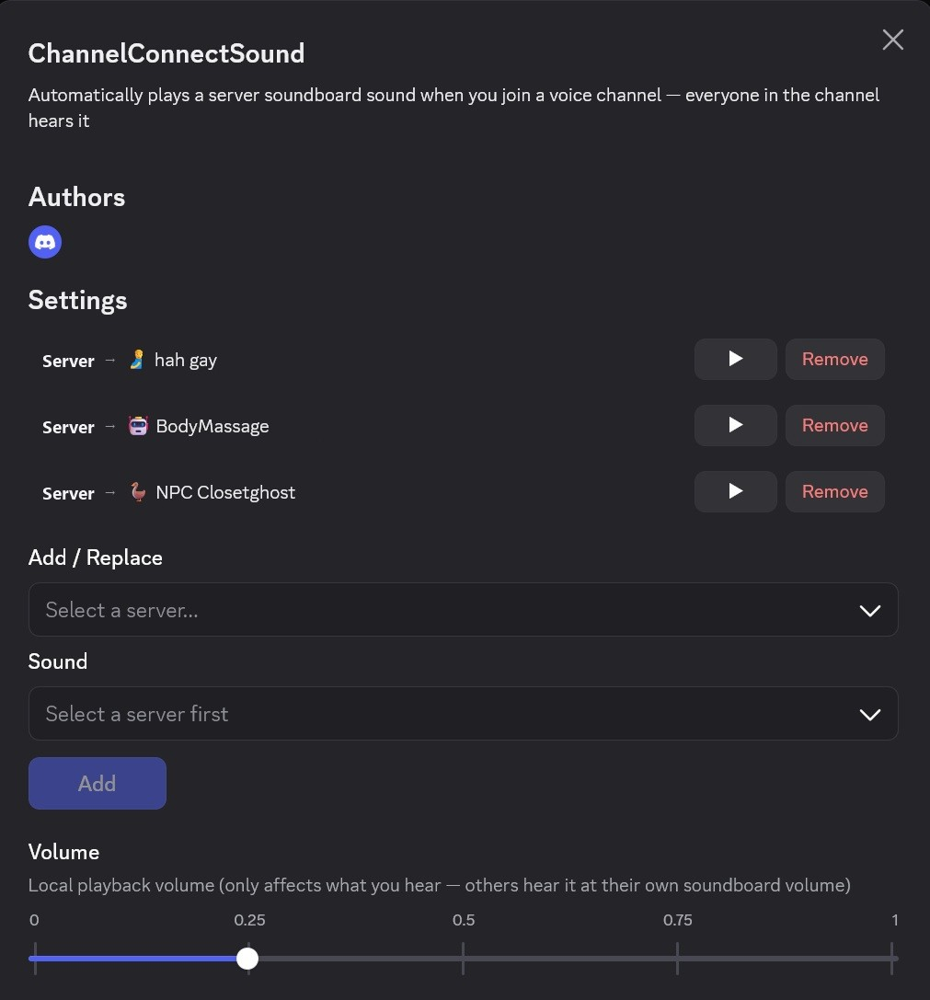

# VoiceConnectSound

A [Vencord](https://vencord.dev) plugin that plays a server soundboard sound when you join a voice channel. Everyone in the channel hears it.

You pick one sound per server. Joining (or switching to) a voice channel in that server plays it automatically.

Install it with the installer in the [main README](../../README.md).

## Set up your connect sounds

1. In Discord, open **User Settings → Vencord → Plugins**.
2. Find **★ VoiceConnectSound** at the top of the list, enable it, and click the cog icon to open its settings.
3. Under **Add / Replace**, select a server.
4. Under **Sound**, select one of that server's soundboard sounds. Use **▶ Preview** to hear it first.
5. Click **Add**.

Repeat for each server you want a sound in. Picking a server that already has a sound changes the button to **Replace**.

- **▶** next to a server plays its sound locally.
- **Remove** clears the sound for that server.
- **Volume** only changes how loud you hear it. Everyone else hears it at their own soundboard volume.

## Notes

- Sounds come from each server's own soundboard, so the server needs at least one soundboard sound.
- You need permission to use the soundboard in the voice channel, the same as playing a sound manually.
- The sound plays about a second after you join, once your voice connection is up.
- If a sound is deleted from the server, you'll get a toast telling you to update your settings.
